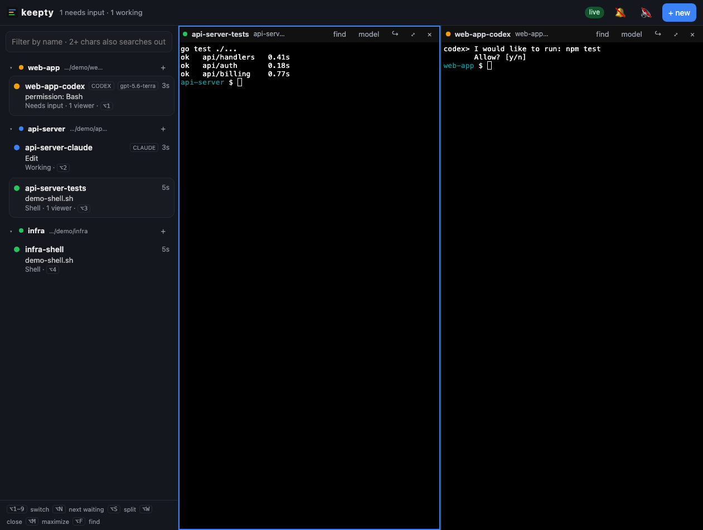
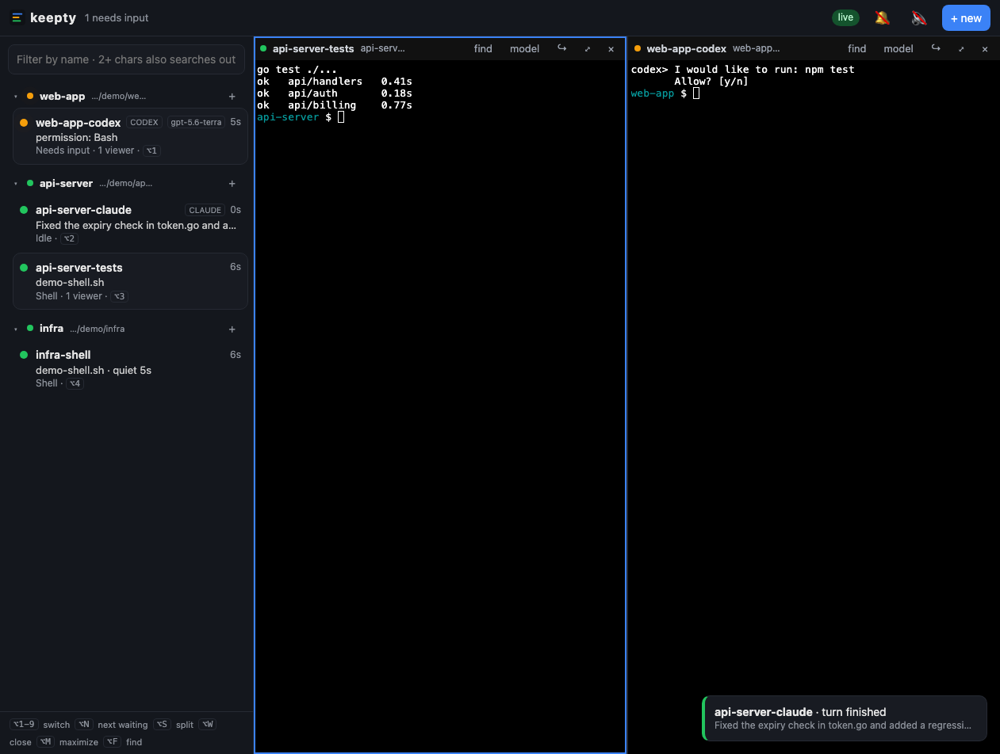
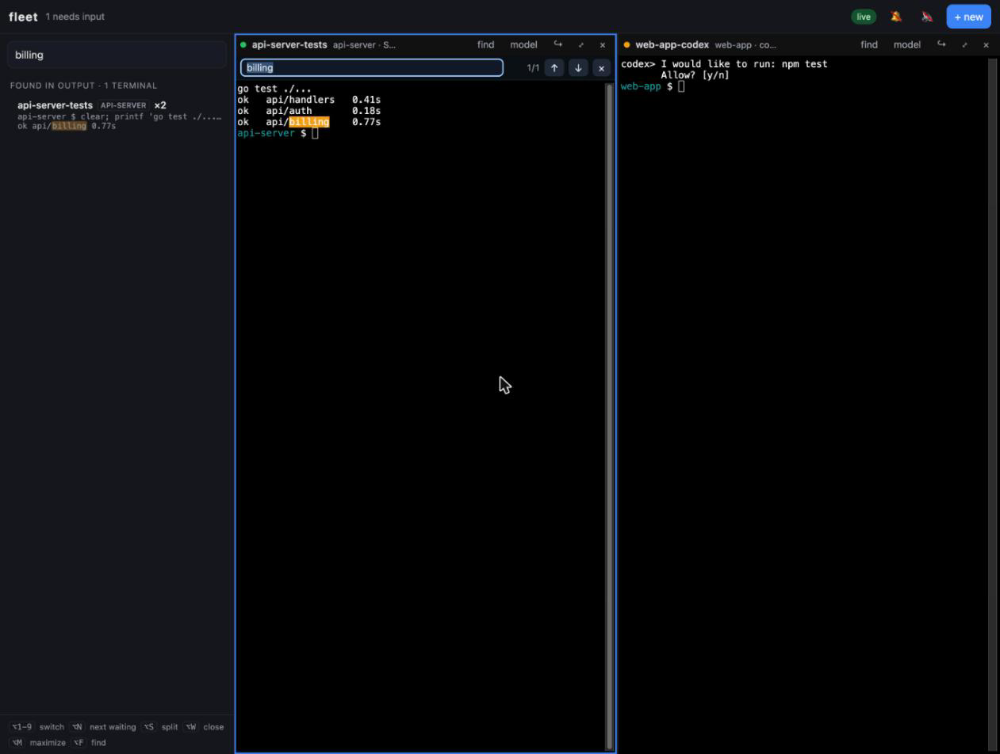
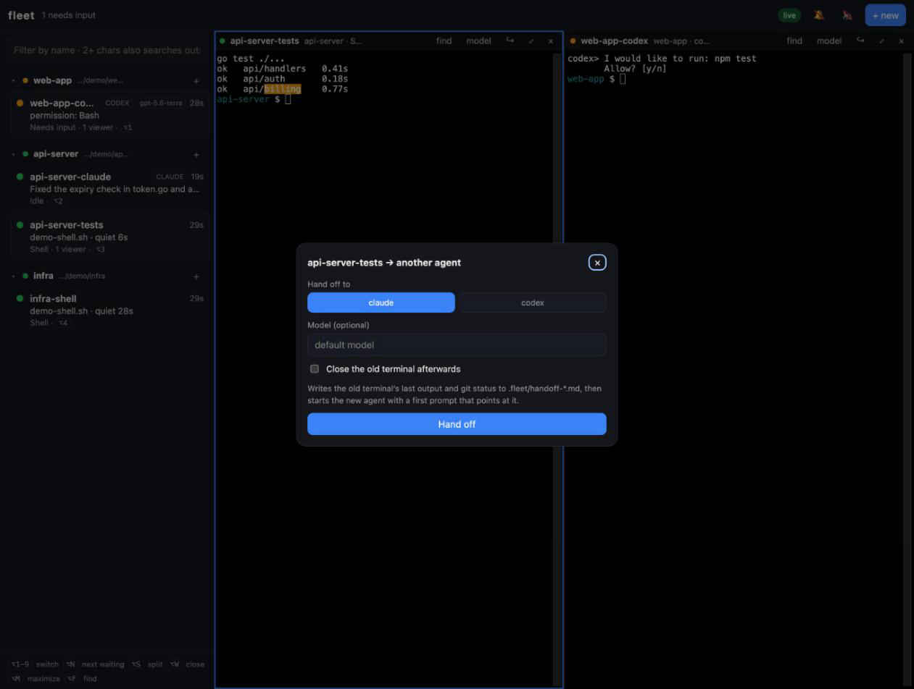
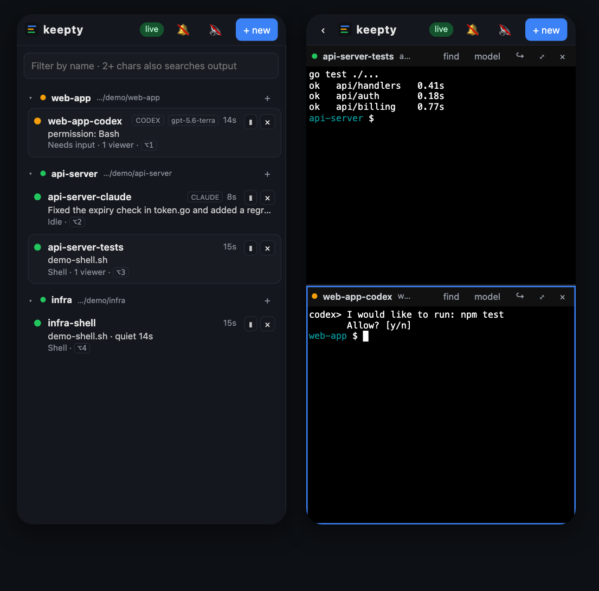
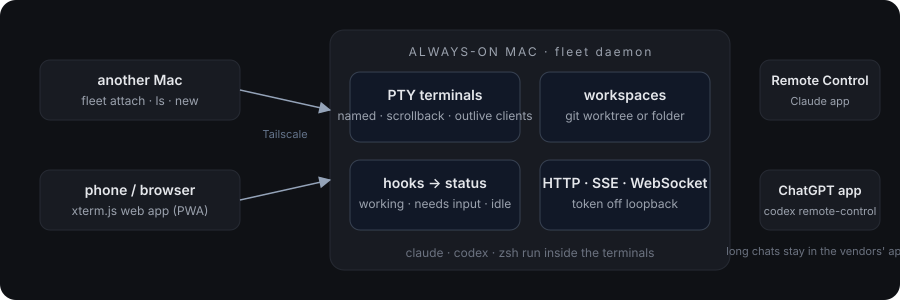

<p align="center">
  <picture>
    <source media="(prefers-color-scheme: dark)" srcset="assets/logo-dark.svg">
    
  </picture>
</p>

<h3 align="center">A lightweight tmux for coding agents.</h3>

<p align="center">
  Run Claude Code and Codex on one always-on Mac. Attach from your other Mac or your phone. Always know which agent needs you.
</p>

<p align="center">
  English | <a href="README.ko.md">한국어</a>
</p>

<p align="center">
  <a href="https://github.com/YoonShinWoong/fleet/releases/latest"></a>
  <a href="https://github.com/YoonShinWoong/fleet/actions/workflows/ci.yml"></a>
  
  
  
</p>

<p align="center">
  <code>go install github.com/YoonShinWoong/fleet/cmd/fleet@latest</code> · or a single binary from <a href="https://github.com/YoonShinWoong/fleet/releases/latest">Releases</a>
</p>

<p align="center">
  
</p>

---

I work from two MacBooks and a phone, and most of my day is a conversation with Claude Code and Codex running in a pile of terminals. The terminal apps built for that kept getting heavier, and none of them kept the things I actually cared about in one place across devices: the sessions themselves, which agent was waiting on me, and the config both agents share.

tmux has the right idea. A session that outlives the client. But it stops at the SSH prompt and knows nothing about agents. So **fleet** keeps the two things from tmux that matter (sessions outlive their clients, and several clients can watch one session), drops everything else (windows, nested panes, key tables, a config language), and adds what an agent workflow needs: a live status per terminal fed by the agents' own hooks, workspaces, handoff from one agent to another, and a web app that is usable on a phone. One static Go binary. No Electron, no tmux, nothing to install on the host but the binary.

## Highlights

- **One daemon, every device.**<br>
  The daemon runs on the Mac you leave on. Terminals live there and survive you closing the lid of the other one. The CLI attaches over WebSocket from any machine (`fleet attach`, no SSH), and the browser gets the same terminals through xterm.js. Off loopback, every request carries a token; put it on Tailscale and forget about it.

- **Know which agent needs you.**<br>
  Claude Code and Codex call `fleet hook` on their own hook events. fleet turns those into *working*, *needs input*, *idle*, *ended* per terminal: a pulsing dot in the list, a count in the tab title, and a toast when an agent finishes a turn or asks a question. Click the toast and you are in that terminal. fleet never wraps `claude` or `codex`; it only listens.

  <p></p>

- **Split, search, switch.**<br>
  Up to four panes in a 2×2 grid, each its own terminal. `⌥1`–`⌥9` jumps to a terminal, `⌥N` to the next one waiting for input. `⌥F` searches inside a terminal with highlighted matches, and typing two characters into the sidebar filter searches the scrollback of *every* terminal at once.

  <p></p>

- **Workspaces, models, handoff.**<br>
  A workspace is a git worktree made for a task, or any folder. Start claude, codex or a plain shell inside it, pick a model at launch or switch it mid-session, and when one agent gets stuck, hand the work to the other: fleet writes the terminal's last output and `git status` to `.fleet/handoff-*.md` and starts the new agent with a first prompt pointing at it.

  <p></p>

- **Phone-sized when it has to be.**<br>
  The same app folds into a list screen and a terminal screen on a phone, with a key bar for esc, tab, ctrl, arrows and a one-tap `y⏎`. Add it to the home screen and it opens full screen. Long conversations still belong in the Claude and ChatGPT apps; fleet is for seeing what is going on and answering the short questions.

  <p></p>

- **Light.**<br>
  A single Go binary around 10 MB with the web app embedded. The host needs nothing else: no Node, no tmux, no browser engine. Everything in `~/.fleet`.

## Installation

### The host (your always-on Mac)

Download the binary for your machine from [Releases](https://github.com/YoonShinWoong/fleet/releases/latest) and put it on your `PATH`:

```sh
curl -L https://github.com/YoonShinWoong/fleet/releases/latest/download/fleet-darwin-arm64 -o ~/.local/bin/fleet
chmod +x ~/.local/bin/fleet
```

Apple silicon is `fleet-darwin-arm64`, Intel is `fleet-darwin-amd64`, and there are Linux builds too. With Go installed, `go install github.com/YoonShinWoong/fleet/cmd/fleet@latest` also works.

```sh
fleet daemon             # first run writes ~/.fleet/config.json with a fresh token; Ctrl-C
fleet service install    # launchd: starts at login, restarts if it dies
fleet hooks install claude
fleet hooks install codex
fleet info               # the address and token your other devices need
```

To reach it from other devices, set `"addr"` in `~/.fleet/config.json` to `"0.0.0.0:7677"` (or your Tailscale IP) and `fleet service restart`. Plug the Mac in and turn on *Prevent automatic sleeping when the display is off*.

`fleet hooks install` adds a `fleet hook` entry to each event in `~/.claude/settings.json` and `~/.codex/hooks.json` without touching the hooks you already have, and leaves a `.bak-fleet` next to each file. Codex asks you once to trust the new hooks. fleet always answers `{}`, so agent behavior never changes, and if the daemon is down the hook gives up quietly within 1.5 seconds.

### Another Mac

```sh
export FLEET_ADDR=100.x.y.z:7677 FLEET_TOKEN=<token from fleet info>
fleet ls
fleet attach fix-login-claude     # detach with Ctrl-\
```

### Phone

Open `http://100.x.y.z:7677` in Safari or Chrome, paste the token once, and add it to the home screen.

## Usage

```sh
fleet ws new fix-login -repo api        # workspace = git worktree of a configured repo
fleet ws new notes -path ~/notes        # or any folder
fleet open fix-login -agent claude -model opus -a   # start claude there and attach
fleet open fix-login                    # a shell in the same place (fix-login-shell)
fleet new api fix-login -agent codex -a # the two lines above in one, workspace named after the task
fleet handoff fix-login-claude -to codex -a         # hand the work to the other agent
fleet model fix-login-claude sonnet     # types /model sonnet into that session
fleet send fix-login-claude "yes, go ahead"
fleet search "connection refused"       # across every terminal's scrollback
fleet kill fix-login-claude
```

| command | what it does |
|---|---|
| `daemon` · `service install\|status\|restart\|log` · `info` | run the host, keep it running, show the address and token |
| `hooks install\|show claude\|codex` | wire the agent's hooks to fleet, keeping existing hooks |
| `ws ls\|new\|rm` | workspaces: a git worktree per task, or any folder |
| `open <ws> [-agent] [-model] [-prompt] [-a]` | start an agent or shell in a workspace |
| `new <repo> <task> [-agent] [-model] [-a]` | workspace named after the task, plus an agent in it |
| `sh <name> [-cwd] [-c]` | a terminal outside any workspace |
| `attach` · `ls` · `send` · `kill` | the tmux verbs |
| `model <term> <model>` · `handoff <term> -to <agent>` | change model mid-session, or change agent |
| `search <text>` | find text in every terminal's scrollback |

In the browser:

| to do this | press |
|---|---|
| open the n-th terminal in the list | `⌥1` … `⌥9` |
| jump to the next terminal waiting for input | `⌥N` |
| add a pane (then pick a terminal for it) | `⌥S` |
| close / maximize the focused pane | `⌥W` / `⌥M` |
| find in the focused terminal | `⌥F`, then `Enter` / `Shift+Enter` |
| open a terminal in a new pane | the `⫼` on its row |
| collapse a workspace | click its header |

## How it works

<p align="center"></p>

- **Terminals** are PTYs owned by the daemon, each running one command (an agent or your shell) in one folder. A 1 MiB raw scrollback is replayed when you attach, and the PTY is sized to the smallest attached client. When a new client attaches, fleet nudges the width by one column so full-screen TUIs repaint.
- **The attach protocol** is one WebSocket per pane: binary frames are PTY bytes in both directions, text frames are JSON control (`resize` in, `exit` out). The CLI and the browser speak the same protocol, so a native client is a small job.
- **Status** comes from hooks. `SessionStart` → idle, `UserPromptSubmit` and tool events → working, `PermissionRequest` / `Notification` → needs input, `Stop` → idle, `SessionEnd` → ended. Unknown events and fields are ignored, so hook schema changes on either side do not break ingestion.
- **Notifications** are made by the client from status transitions, not by the server, because which transitions deserve a ping is a matter of taste.
- **Workspaces** persist in `~/.fleet/workspaces.json`. Terminals do not survive a daemon restart, same as tmux.

The longer version, including what was deliberately left out and why, is in [docs/DESIGN.md](docs/DESIGN.md) (Korean).

## Configuration

`~/.fleet/config.json` is created on first run. The parts you are likely to touch:

| key | meaning | default |
|---|---|---|
| `addr` | listen address; use `0.0.0.0:7677` or a Tailscale IP for other devices | `127.0.0.1:7677` |
| `token` | bearer token required off loopback | generated |
| `repos` | name → path, offered when creating a worktree workspace | `{}` |
| `worktreeRoot` | where task worktrees go | `~/fleet/worktrees` |
| `agents.<name>.command` | how to start the agent | `claude --remote-control`, `codex` |
| `agents.<name>.modelFlag` | flag used to pass a model at launch | `--model`, `-m` |
| `agents.<name>.models` | suggestions in the model pickers | claude: `fable opus sonnet haiku` |
| `agents.<name>.modelCommand` | typed into a running session to switch model; `{model}` is substituted | `/model {model}`, `/model` |
| `handoffPrompt` | first prompt for the agent receiving a handoff; `{from}` `{to}` `{file}` | see config |
| `scrollbackBytes` | raw scrollback kept per terminal | `1048576` |

Any command works as an agent. Add `"aider": {"command": "aider"}` and it shows up in every picker.

## Roadmap

- **v0.2** One MCP registry rendered into Claude's user scope, Codex's `config.toml` and per-repo `.mcp.json`, with per-host `doctor` that disables servers you cannot reach. One memory bundle both agents read.
- **v0.3** Push notifications to a phone that has the app closed, PWA install polish, and a virtual terminal parser so re-attaching to a TUI shows a clean screen instead of a replay.
- **v0.4** An MCP proxy so each MCP server runs once per machine instead of once per session, and a nightly distiller that proposes memory entries from both agents' transcripts.

## Status

Early, and used daily by one person. Things to know:

- Terminals die with the daemon. Hooks and workspaces survive.
- Scrollback replay is raw bytes; full-screen TUIs rely on the resize nudge to repaint.
- Codex's `Notification` hook is partial upstream, so *needs input* for Codex can lag a turn.
- There is no auth beyond the token. Keep the daemon inside a private network.

## License

[MIT](LICENSE)
